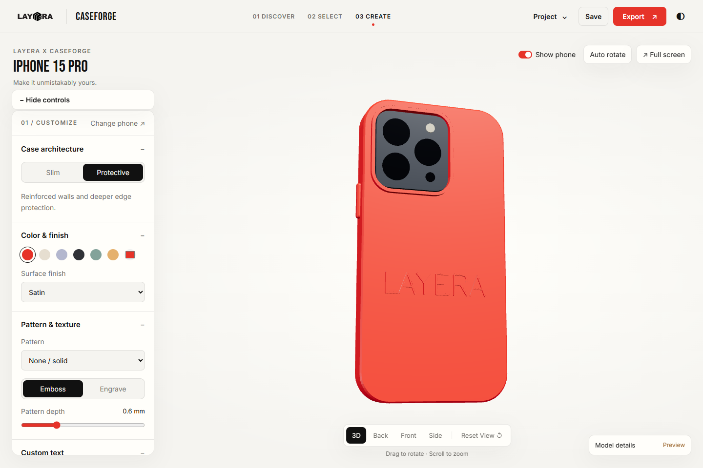
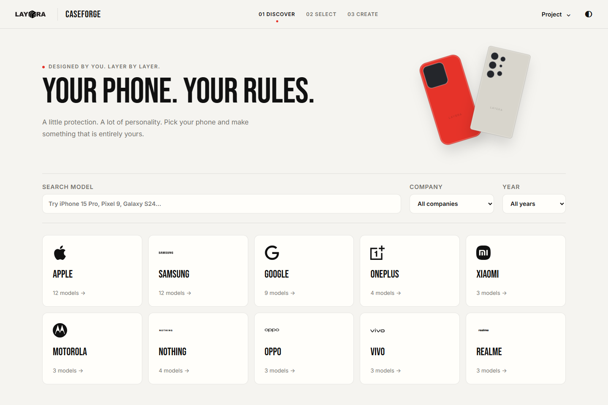
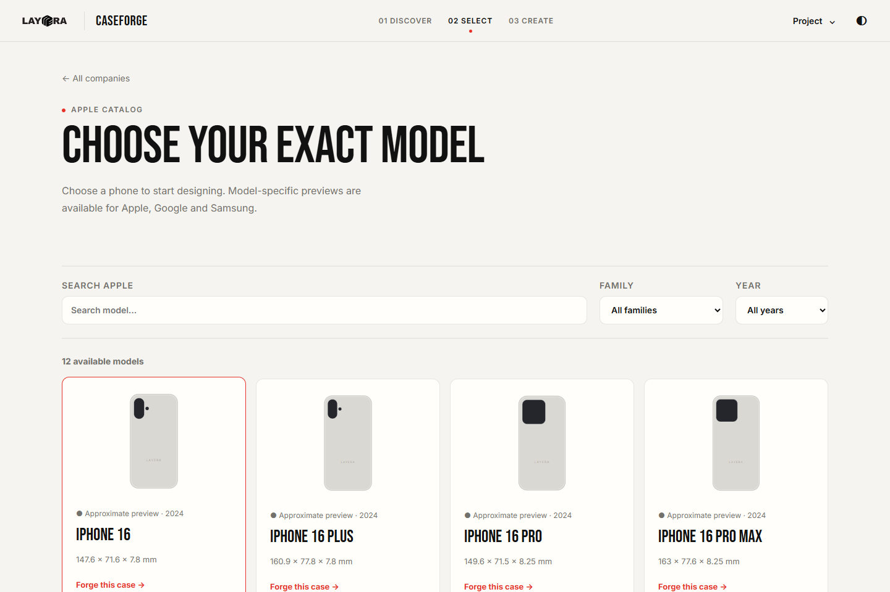

# Layera X Caseforge

A local phone-case design studio built with Next.js, React, Three.js, and JSCAD. Choose a phone, customize its case, inspect the interactive 3D preview, and save or share the design as JSON.

**Current status:** this is a design preview prototype. No phone model has certified physical fit, and production STL export is disabled for the current catalog.

## Screenshots

### 3D case editor

Customize an iPhone 15 Pro case with colors, finishes, patterns, and text while inspecting the live 3D preview.



### Brand selection

Browse supported brands or search for a phone model from the starting screen.



### Phone catalog

Compare models within a brand before opening the case editor.



## Features

- Browse and search phones from Apple, Samsung, Google, OnePlus, Xiaomi, Motorola, Nothing, Oppo, Vivo, and Realme.
- Choose slim or protective cases, custom colors, and matte, satin, or gloss finishes.
- Apply solid, diagonal, grid, dots, or waves patterns with adjustable relief and placement.
- Add embossed or engraved text with position, scale, rotation, and depth controls.
- Rotate the 3D preview or use Back, Front, Side, and 3D camera presets.
- Show the phone inside the case, adjust its opacity, hide controls, or enter full screen.
- Switch between light and dark themes.
- Save locally or export and import JSON project files.

## Requirements

- Node.js 22.12 or newer and npm. This covers the requirements of the installed application and development tooling.
- A modern browser with WebGL support, such as Chrome or Edge.
- Internet access for the initial dependency installation. The local app uses bundled fonts and assets; external reference links require internet access.

No API keys, database, or environment-variable setup is required for the current prototype.

## Quick start

Open a terminal in the project folder, then run:

```sh
npm ci
npm run dev
```

Open [http://localhost:3000](http://localhost:3000). The home route redirects to `/case-generator`.

Keep the terminal running while using the app. Press **Ctrl+C** to stop the server. Development mode reloads the app when source files change.

On Windows PowerShell, use `npm.cmd` instead of `npm` if PowerShell blocks the npm script:

```powershell
npm.cmd ci
npm.cmd run dev
```

### Windows presentation launcher

If dependencies are already installed, double-click **Start-Caseforge.cmd** and open [http://localhost:3000](http://localhost:3000).

The launcher checks that Next.js is installed, builds with Webpack if `.next/BUILD_ID` is missing, and starts the production server on `127.0.0.1:3000`. Keep its window open. If the app is already running, use the existing server instead of starting another one.

**The launcher reuses an existing production build.** After changing source files, stop the server and rebuild before launching again.

### Production build

```sh
npm run build -- --webpack
npm run start -- --hostname 127.0.0.1
```

The explicit Webpack option matches the included launcher and the project's documented production verification.

If the npm launcher is unavailable but Node.js and dependencies are installed, run Next.js directly:

```sh
node node_modules/next/dist/bin/next dev
```

For a production build and server, use:

```sh
node node_modules/next/dist/bin/next build --webpack
node node_modules/next/dist/bin/next start --hostname 127.0.0.1
```

## Design your first case

1. Select a company and phone model, for example **Apple > iPhone 15 Pro**.
2. Choose the case style, color, and finish.
3. Add a pattern or text, then adjust the decoration controls.
4. Use the camera presets and **Show phone** to inspect the design.
5. Open **Model details** to review reference sources and physical-fit limitations.
6. Click **Save** to keep the design in this browser, or **Export** to download a project JSON file.

To try an existing design, select **Project > Import JSON** and choose [docs/demo-project.json](docs/demo-project.json).

## Saving and sharing

| Action | What it does |
| --- | --- |
| **Save** | Writes the current phone and configuration to one local browser save slot, replacing the previous save. |
| **Project > Resume saved project** | Restores that saved phone and configuration after reopening or reloading the app. |
| **Export** or **Project > Export JSON** | Downloads a JSON project file for backup or sharing. |
| **Project > Import JSON** | Loads a supported project file and restores its phone and configuration. Save afterward to keep it in the local save slot. |

Saving is manual: unsaved edits are not automatically restored after reload. Local saves belong to the browser and site address used to create them; they do not sync across devices. Export JSON to keep multiple designs or a portable backup.

The URL records the selected company and model, but does not contain the full design. Share a JSON file to share customization settings.

Project files use schema version 3. Versions 1 and 2 are migrated on import. Imports must be valid Caseforge JSON files no larger than 1 MiB and must reference a known phone model.

## Model accuracy and STL export

The catalog contains 56 phones. The 33 Apple, Google, and Samsung models have reference-informed visual profiles; the remaining 23 use generic approximate profiles. Feature positions and clearances remain estimates until measured and physically tested.

**A plausible preview does not establish a printable or properly fitting case.** The main **Export** button downloads project JSON, not STL.

**Project > Download validated STL** stays disabled until the selected model passes the release workflow. Export checks include release metadata, the approved asset's SHA-256 checksum, and validated customization limits. Changing a model's status label alone does not enable export.

See the [model accuracy checklist](docs/model-accuracy.md) for model-specific evidence and gaps, and the [geometry release workflow](docs/geometry-release.md) for physical testing and release requirements.

## Development commands

Run these commands from the project root:

| Command | Purpose |
| --- | --- |
| `npm run dev` | Start the development server. |
| `npm run build -- --webpack` | Create the production build using Webpack. |
| `npm run start` | Serve an existing production build. |
| `npm run lint` | Run ESLint. |
| `npm test` | Run the Vitest test suite once. |
| `npm run test:watch` | Run tests in watch mode. |
| `node node_modules/typescript/bin/tsc --noEmit` | Check TypeScript types without emitting files. |

For machines with limited resources, run tests with one worker:

```sh
node node_modules/vitest/vitest.mjs run --maxWorkers=1
```

Tests cover project parsing and restoration, device profiles, case geometry, worker request ordering, released geometry, and export restrictions. Earlier test and browser results are recorded in [docs/verification.md](docs/verification.md); that document is a historical verification snapshot.

## Project structure

```text
app/                         Next.js routes, layout, and global styles
  page.tsx                   Redirects to the case generator
  case-generator/page.tsx    Case-generator entry point
components/                  Phone selection, case editor, and 3D preview UI
lib/
  catalog.ts                 Phone catalog and device metadata
  device-profiles.ts         Reference-informed visual geometry profiles
  project.ts                 Defaults, project validation, and schema migration
  geometry.ts                Procedural case geometry
  geometry.worker.ts         Background geometry generation
  geometry-engine.ts         Preview geometry orchestration
  released-geometry.ts       Approved geometry asset loading and verification
  release.ts                 Production-export eligibility checks
  export.ts                  JSON and STL downloads
  *.test.ts                  Automated tests
public/                      Bundled fonts, brand assets, and static files
docs/                        Demo project, accuracy checklist, and release workflow
Start-Caseforge.cmd           Windows production launcher
```

The UI uses React Three Fiber and Drei to render Three.js geometry. JSCAD generates case geometry in a dedicated web worker, with base-case caching, transferable mesh buffers, request coalescing, and stale-result rejection. Color, finish, and visibility changes do not regenerate geometry. If generation fails, the preview retains the last valid mesh and offers a retry.

For local performance inspection, the preview exposes `data-render-fps` and `data-geometry-ms`, and the editor exposes `data-input-latency-ms`. FPS uses a two-second rolling sample. Input latency measures the configuration handler to the next animation frame, not complete browser event latency.

## Troubleshooting

| Problem | What to do |
| --- | --- |
| Dependencies are missing | Run `npm ci` in the project root, then start the app again. |
| PowerShell blocks npm | Use `npm.cmd`, or use the direct Node.js commands above once dependencies are installed. |
| Port 3000 is already in use | Open the existing app if it is this project, stop its server, or use `npm run dev -- --port 3001`. |
| Source changes do not appear with the launcher | Stop the server, run `npm run build -- --webpack`, and restart. |
| A saved project is missing | Use the same browser and site address, then select **Resume saved project**. If browser storage was cleared, import a JSON backup. |
| Import reports an invalid project | Use an exported Caseforge JSON file or the bundled demo, within the 1 MiB limit. |
| Full screen is unavailable | Try Chrome or Edge directly, or use F11 on Windows. Embedded browsers may restrict full-screen requests. |
| STL download is disabled | This is expected for the current preview-only catalog. Review the model's release requirements. |

## Assets and attribution

The prototype uses Layera Studio's public logo. Inter and Bebas Neue fonts are bundled locally; their SIL Open Font License files are included in [public/fonts](public/fonts/).
